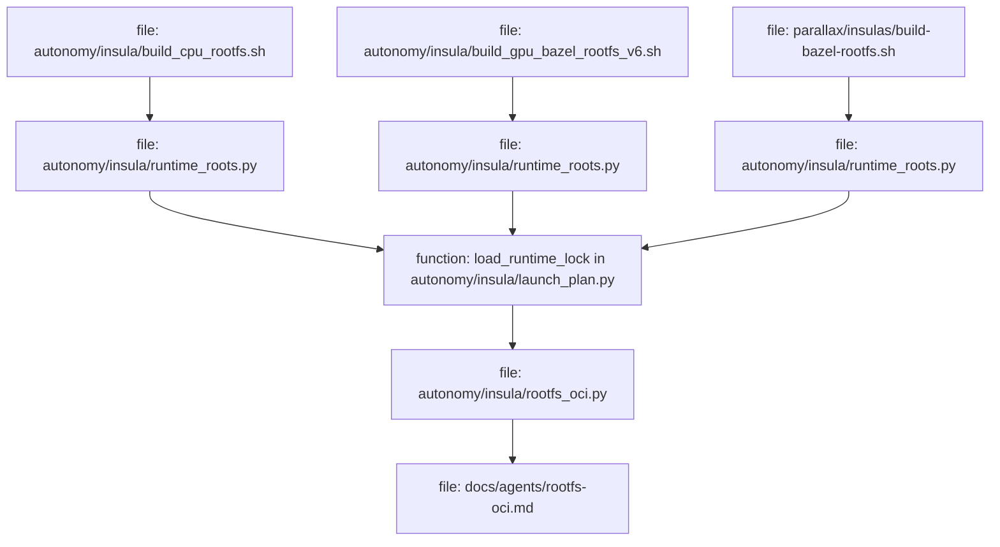
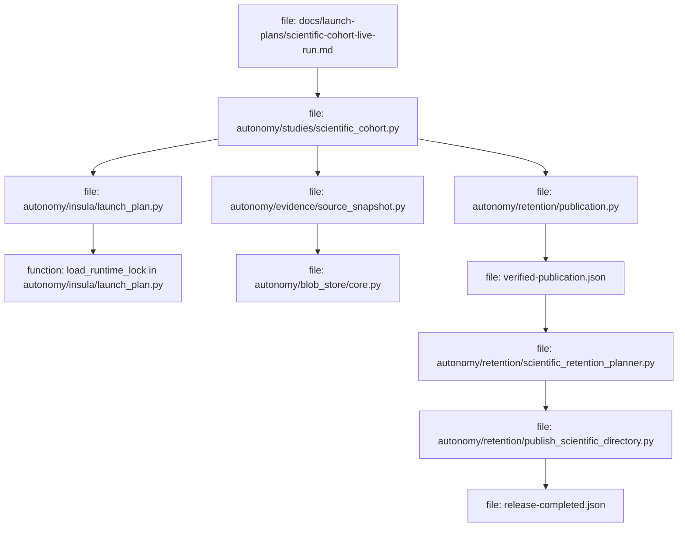

# Build And Verify

Sureal build and verification work crosses two boundaries:

- `./bazelw` is the build and test boundary. It enters the selected Insula
  rootfs, then runs Bazel from that rootfs.
- Retained scientific evidence is a publication boundary. A live run records
  launch-plan checked runtime locks, source snapshots, blob-store records and
  retention receipts.

Use this guide to follow a change from edit to gate and, when the task is a
live scientific run, onward to retained evidence. The command catalogue remains
in [AGENTS.md](../../AGENTS.md#commands); this guide explains how the pieces
fit together and where each lock, digest and receipt is created.

## Edit To Gate Flow

```mermaid
flowchart LR
  Edit["repo edit: docs/guides/build-and-verify.md"] --> Cmd["command: ./bazelw test //:repo_gate"]
  Cmd --> Wrapper["file: bazelw"]
  Wrapper --> Launcher["file: autonomy/insula/bazel_launcher.py"]
  Launcher --> Roots["file: autonomy/insula/runtime_roots.py"]
  Roots --> Lock["function: load_runtime_lock in autonomy/insula/launch_plan.py"]
  Lock --> Plan["function: sandbox_plan in autonomy/insula/bazel_launcher.py"]
  Plan --> Bazel["command: bazel test"]
  Bazel --> RepoGate["target: //:repo_gate"]
```



The wrapper starts in the repository root, changes to `autonomy/`, and executes
`python -m insula.bazel_launcher`. The launcher selects the rootfs from the
Bazel arguments:

- `--config=cuda` selects `current_gpu_rootfs()` from
  `autonomy/insula/runtime_roots.py`.
- A Parallax-only target such as `//parallax/...` selects
  `current_curriculum_rootfs()`.
- Default repository and Autonomy targets select `current_cpu_rootfs()`.

The launcher refuses a target pattern that spans Autonomy and Parallax because
one command cannot use both root filesystems. Split those runs into the
component commands from `AGENTS.md`.

Run the static repository gate before landing:

```bash
./bazelw test --noexperimental_collect_system_network_usage --nocache_test_results --test_output=errors //:repo_gate
```

Run the broader CPU, CUDA and Parallax suites when the change can affect them:

```bash
./bazelw test --noexperimental_collect_system_network_usage --nocache_test_results --test_output=errors //autonomy/...
CUDA_VISIBLE_DEVICES=1 ./bazelw test --config=cuda --noexperimental_collect_system_network_usage --nocache_test_results --test_output=errors //autonomy/...
./bazelw test --noexperimental_collect_system_network_usage --nocache_test_results --test_output=errors //parallax/...
```

Use the CUDA command only when GPU 1 is actually free. The default `.bazelrc`
test tier excludes `requires_gpu`, `requires_live_gate` and `known_failure`.
The `--config=cuda` tier includes `requires_gpu`, still excludes
`requires_live_gate` and `known_failure`, and sets `SUREAL_REQUIRE_GPU=1` in
the Bazel test environment. A requested GPU test should fail clearly when CUDA
is masked instead of silently skipping.

Tests tagged `requires_live_gate` run only when a command explicitly requests
that live tier. `_live_test.py` names tests that touch live runtime state or
external assets. `_host_test.py` names host-facing wrapper tests that still run
through `./bazelw` unless a documented static hook says otherwise.

## Rootfs Build, Lock And Persistence Flow



Rootfs rebuilds are specialized work. Do not run the build scripts during
ordinary feature work. When a rootfs rebuild is the task, the relevant script
creates a rootfs and its adjacent `.lock.json`, then
`load_runtime_lock()` verifies the rootfs content digest and the recipe or
image-form inputs recorded by that lock. `docs/adr/0002-bazel-runs-inside-insula.md`
is the policy: Bazel and dependencies come from the rootfs, never from host
packages.

The active rootfs names and default `~/.cache/waystone/...` locations live in
`autonomy/insula/runtime_roots.py`. The default lock path is the rootfs path
with `.lock.json` appended. `autonomy/insula/launch_plan.py` checks:

- `rootfs_sha256`, computed from the rootfs tree by
  `autonomy/insula/runtime_identity.py`;
- recipe hashes for CPU, GPU and Parallax Bazel rootfs trees;
- image-form metadata for metrics and motion rootfs trees;
- the Bazel version and downloaded Bazel binary digest when the rootfs carries
  Bazel.

Rootfs registry persistence is documented in
`docs/agents/rootfs-oci.md` and implemented by
`autonomy/insula/rootfs_oci.py`. A dry run writes an OCI layout to a caller
scratch directory outside the repository and outside `~/.cache/waystone`. A
real GHCR push or pull is coordinator-only for the rootfs-rebuild workflow.
The OCI manifest records the rootfs role, rootfs name, lock sha256,
`rootfs_sha256`, archive sha256, archive size, rootfs manifest sha256, part
count and file count. Restore refuses an existing rootfs, stages the extracted
tree beside the target, verifies it through `load_runtime_lock()`, and promotes
the tree and lock only after that check accepts the bytes.

## Live Run To Retained Evidence Flow



Live scientific work is not just a test run. It starts from a written plan such
as `docs/launch-plans/scientific-cohort-live-run.md`, then records enough
evidence to rerun or audit the result later. The current launch-plan ADR is
`autonomy/docs/adr/0003-executions-are-described-by-launch-plans.md`: active
launches are described by runtime locks, mounts, devices, environment, working
directory and command. Callers build a plan and render it only when launching;
they do not splice old command lines from receipts.

Source snapshots are owned by `autonomy/evidence/source_snapshot.py`. The
snapshot code queries the Bazel source closure for a target, writes a
deterministic tar archive, hashes that archive, stores it as
`artifacts/source-snapshots/<sha256>` through the blob store, and records both
the archive digest and per-file `source_pins`. Per
`autonomy/docs/adr/0001-source-pins-refer-to-snapshots.md`, a source pin points
to that archived snapshot, not to the current working tree.

Evidence blobs go through the backend-neutral blob store described by
`autonomy/docs/adr/0002-evidence-blobs-go-through-a-blob-store.md` and
implemented in `autonomy/blob_store/core.py`. A blob record is a key, sha256 and
byte count plus a store descriptor such as `{kind: "waystone", project:
"sureal"}` in the receipt. Receipts do not name a host storage root.

Retention publication is implemented by `autonomy/retention/publication.py`.
Publication specs name the area, child, run id, kind, staging mode, archive or
direct-file mode, store descriptor, tool digest and staging root. `publish()`
stages the inventory, writes archive chunks or direct files, writes a manifest,
stores every blob, reads the blobs back through `audit()`, and only then
returns a receipt with `verified_by_readback: true`.

Retention commands then write durable receipt files:

- `autonomy/retention/publish_sustained_checkpoint.py` writes
  `verified-publication.json` and, when `--release` is used,
  `release-completed.json`.
- `autonomy/retention/publish_scientific_directory.py` writes
  `verified-publication.json` and, when `--release` is used,
  `release-completed.json`.
- `autonomy/retention/publish_research_journal.py` updates the journal
  publication receipt after preserving legacy receipt bytes.

The retention planner is dry-run by default:

```bash
PYTHONPATH=autonomy python3 autonomy/retention/scientific_retention_planner.py
```

Review the plan before using `--apply`. Apply deletes only stray logs and
digest-verified leftovers from already released runs, writes an apply receipt,
and refuses to delete evidence roots, protected scientific children or live
referenced scientific data.

## Digest Chain

- `MODULE.bazel.lock`: Bazel external dependency lock. The launcher passes
  `--lockfile_mode=error` unless `./bazelw --update-lock` is explicitly used.
- Runtime lock sha256: `load_runtime_lock()` reads the adjacent `.lock.json`.
  Receipts and rootfs OCI metadata name that lock digest when they bind a
  rootfs.
- `rootfs_sha256`: `autonomy/insula/runtime_identity.py` computes the rootfs
  content digest that must match the runtime lock.
- Source snapshot sha256: `autonomy/evidence/source_snapshot.py` hashes the
  deterministic tar for the Bazel target source closure and stores it under
  `artifacts/source-snapshots/<sha256>`.
- Blob sha256 and byte count: `autonomy/blob_store/core.py` records these for
  every stored manifest, archive chunk or direct file.
- Publication receipt sha256: retention release files use the sha256 of
  `verified-publication.json` as the receipt binding.
- Release plan digests: `release-completed.json` records each released local
  path with sha256 and byte count before cleanup can treat those bytes as
  released leftovers.
- Rootfs OCI manifest digest: `autonomy/insula/rootfs_oci.py` publishes or
  restores rootfs artifacts by manifest digest, and the package tag uses the
  first 12 hex characters of the runtime-lock sha256.

## Boundary Debugging

Wrong rootfs selected: run the same command with `--emit-plan` and inspect the
reported `rootfs`, `lock`, `bazel` and `mounts` fields:

```bash
./bazelw --emit-plan test //:repo_gate
./bazelw --emit-plan test //parallax/...
./bazelw --emit-plan test --config=cuda //autonomy/...
```

If the launcher reports that a target pattern spans Autonomy and Parallax, split
the run into `//autonomy/...` and `//parallax/...` so the wrapper can choose one
rootfs per command.

GPU masked under `--config=cuda`: the CUDA tier sets `SUREAL_REQUIRE_GPU=1`.
Look at `autonomy/insula/gpu_visibility.py`,
`autonomy/insula/gpu_visibility_guard_test.py` and the emitted plan's GPU
fields. If no CUDA device is visible, the requested GPU test should fail with a
message naming the device visibility problem.

Stale source snapshot or retained evidence conflict: start with
`//:pinned_sources_test` and `autonomy/evidence/source_snapshot.py`. Do not edit
retained receipts, source snapshots, root filesystems or locks to make a check
pass. Historical receipts may point at old bytes; source pins are verified
against source snapshots, not the current working tree.

ShellCheck, Ruff, shfmt or clang-format scope surprise: inspect the repo-gate
target named by the failure in `BUILD.bazel`, then inspect the owning script:

- `scripts/repo_gate_shellcheck_test.py`
- `scripts/repo_gate_shell_style_test.py`
- `scripts/repo_gate_shfmt_test.py`
- `scripts/repo_gate_ruff_test.py`
- `scripts/repo_gate_clang_format_test.py`
- `scripts/check_shell_style.py`
- `scripts/ruff_repo.py`
- `scripts/clang_format_repo.py`

The scope is derived from tracked repository files with exclusions for
historical archives and submodules. Fix the active file or update the owning
policy in the same change; do not reformat retained receipts or source snapshots.
